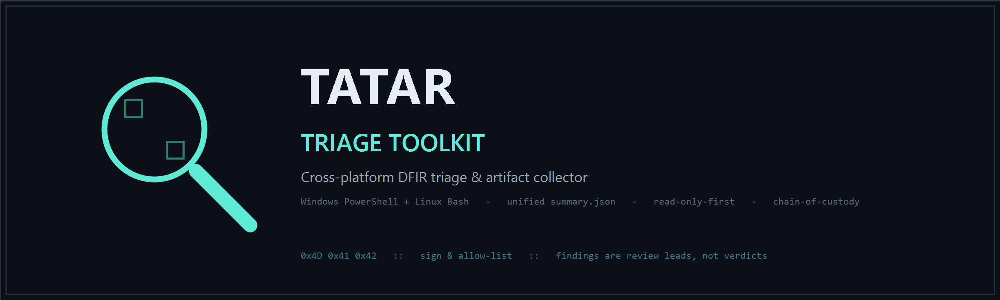
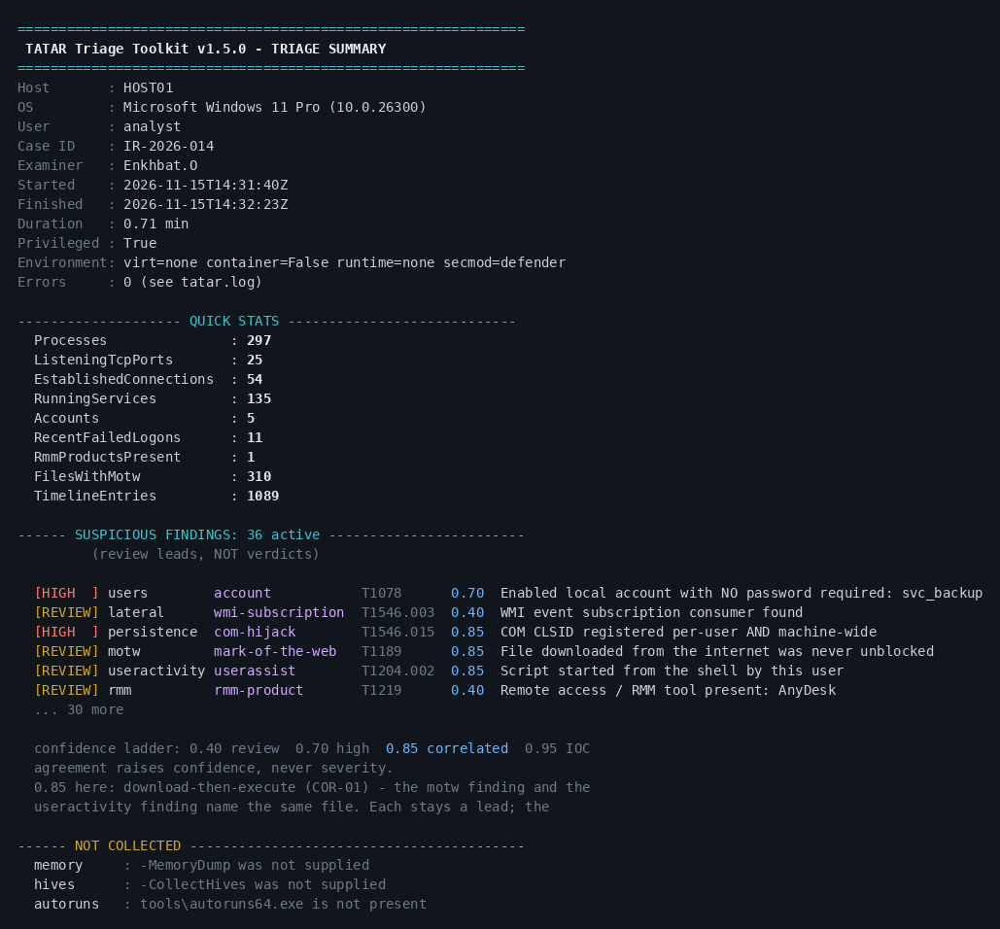

<p align="center">
  
</p>

<p align="center">
  <b>Fast, single-file DFIR triage collector for Windows (PowerShell) and Linux (Bash).</b>
</p>
<p align="center">
  <b>English · <a href="README.mn.md">Монгол</a></b>
</p>

<p align="center">
  
  
  
  
  
  
  
</p>

---

When an endpoint shows signs of compromise you need to preserve evidence *quickly*, without installing a dozen tools. TATAR collects the volatile and persistent artifacts that matter, in order of volatility, into one hashed evidence folder, and writes a one-page summary of **leads for review** (not verdicts).

> Built for first responders and analysts who need triage logs **fast**, on-scene, with no dependencies.

## Quick start

**Windows** (PowerShell 5.1+, Administrator recommended):

```powershell
Set-ExecutionPolicy -ExecutionPolicy Bypass -Scope Process -Force
.\Tatar.ps1 -All -OutputPath E:\Evidence -CaseId IR-2026-014 -Examiner "Name" -Compress
```

**Linux** (Bash, root recommended):

```bash
chmod +x linux/tatar-linux.sh
sudo ./linux/tatar-linux.sh --all --output /mnt/usb/evidence --caseid IR-2026-014
```

Add `-List` / `--list` to see the modules and `-DryRun` / `--dry-run` to check the plan without writing anything. Every run ends with an exit code (0 clean, 2 finished with issues) and a folder you can open with the offline [`viewer`](tools/viewer.html).

## What you get

- **33 modules** on Windows and 18 on Linux, run in RFC 3227 order of volatility, behind one output contract (`schemaVersion 1.7`).
- **Read-only first.** Heavy or destructive actions (memory dump, hive save, full EVTX) are off unless you switch them on. It never extracts or decrypts passwords.
- **Standard user, offline, AV-safe.** No network calls, no obfuscation, no AV/AMSI bypass. [What it does and does not do on a live host](docs/AV-SAFETY.md).
- **Evidence you can verify.** SHA-256 manifest of every file, chain of custody, release attestation.
- **Findings with identity.** Each finding has a stable `fingerprint`, so two scans of a host can be compared (see the tools below).

Not a sandbox, not a memory analyser, not full-disk forensics: it answers one question quickly, *what is wrong on this machine right now, and where should I look first?*

<p align="center">
  
</p>

## Analysis tools

Run on the analyst's machine, standard library only, offline ([details](docs/TOOLS.md)):

| Tool | Answers |
|---|---|
| `tools/viewer.html` | Read a run in the browser, offline |
| `tools/tatar-diff.py` | What changed since the baseline scan? |
| `tools/tatar-timeline.py` | What happened, in what order? (Timesketch CSV) |
| `tools/tatar-aggregate.py` | Which host differs from the rest? |

## Documentation

| Read this | For |
|---|---|
| [Usage](docs/USAGE.md) | Requirements, every option, exit codes |
| [Modules and ATT&CK](docs/MODULES.md) | What each module collects, technique mapping |
| [Output](docs/OUTPUT.md) | Summary, findings, execution log, folder layout |
| [Analysing the evidence](docs/ANALYSIS.md) | Correlation, Sigma hand-off, what to do next |
| [What the evidence is](docs/EVIDENCE.md) | `artifactClass`, platform differences, known-answer checks |
| [Architecture](docs/ARCHITECTURE.md) | Data flow, findings model, allowlist and IOC engines |
| [Handling and limits](docs/OPERATIONS.md) | Operational notes, AV, known limitations |
| [Linux edition](linux/README.md) | The Bash collector on its own |
| [Changelog](CHANGELOG.md) | Every release |
| [Security testing](docs/SECURITY-TESTING.md) · [Validation](docs/VALIDATION.md) | How it is tested, lab results |

Each document has a Mongolian twin (`.mn.md`).

## Legal

For **authorized** use only: systems you own or have explicit written permission to examine. You are responsible for complying with applicable law and policy.

## Contact

**Author:** Enkhbat.O, Security Analyst ·
[Facebook](https://www.facebook.com/enkhbat.o/) · [GitHub](https://github.com/ochmunkh)

Found a security problem in the tool itself? See [`SECURITY.md`](SECURITY.md) and report it privately. Want to contribute? [`CONTRIBUTING.md`](CONTRIBUTING.md).

## License

MIT (see `LICENSE`).
