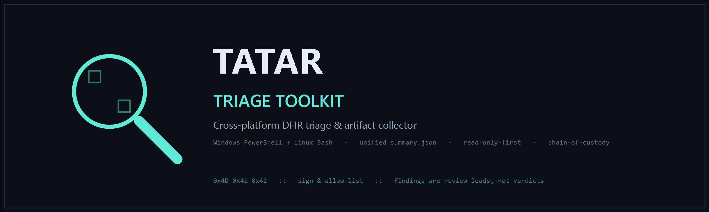
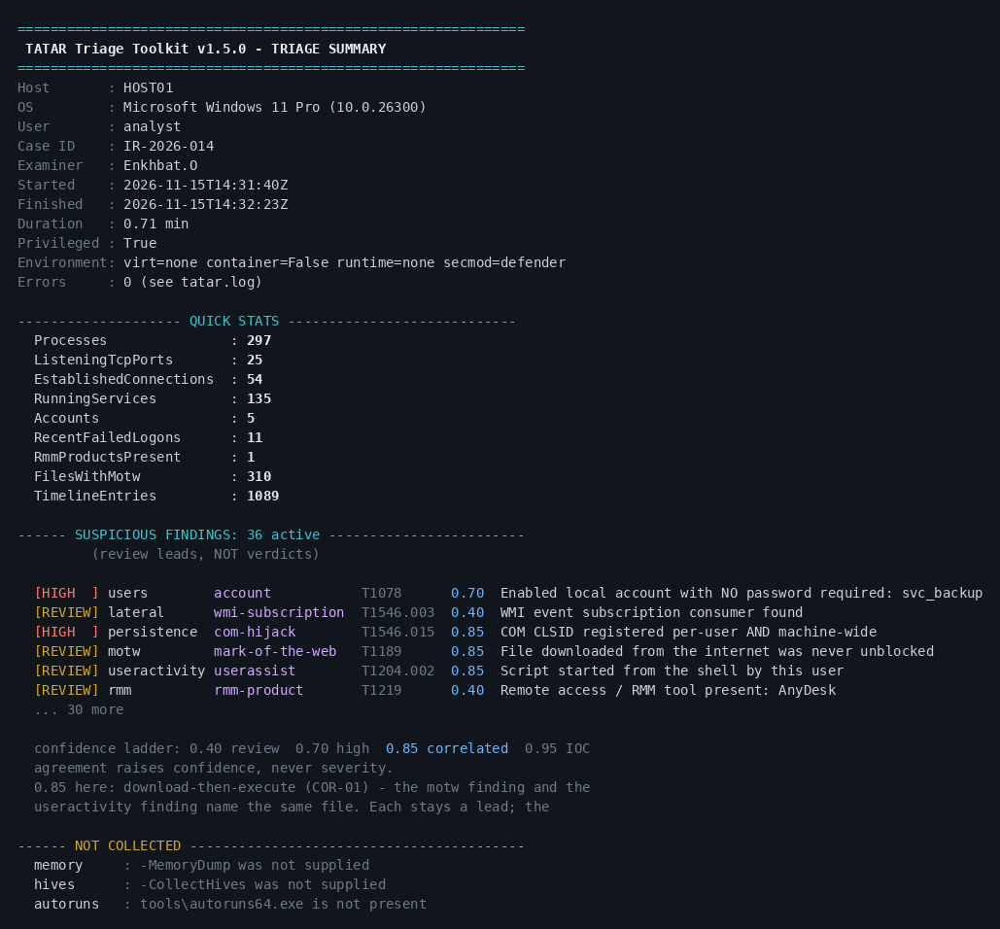

<p align="center">
  
</p>

<p align="center">
  <b>Windows (PowerShell) ба Linux (Bash)-д зориулсан хурдан, нэг файлтай DFIR triage цуглуулагч.</b>
</p>
<p align="center">
  <b><a href="README.md">English</a> · Монгол</b>
</p>

<p align="center">
  
  
  
  
  
  
  
</p>

---

Төгсгөлийн төхөөрөмж халдагдсан байж болзошгүй үед олон хэрэгсэл суулгахгүйгээр нотолгоог *хурдан* хадгалах шаардлагатай болдог. TATAR нь чухал түр зуурын болон тогтвортой артефактуудыг volatility-ийн дарааллаар нэг хэшлэгдсэн хавтаст цуглуулж, **review хийх сэжүүрүүдийн** (эцсийн дүгнэлт биш) нэг хуудас дүгнэлт үүсгэнэ.

> Хээрийн нөхцөлд, нэмэлт хамаарал багатай, triage логийг хурдан гаргах шаардлагатай эхний хариу арга хэмжээ авагч, шинжээчдэд зориулав.

> **Юу ч машинаас гардаггүй.** Tatar Triage сүлжээний дуудлага хийдэггүй, телеметри илгээдэггүй, акаунт шаарддаггүй (AV-01). Энгийн хэрэглэгчээр ажиллаж, шалгаж буй хост дээр юуг ч өөрчилдөггүй, юу ч суулгадаггүй (AV-07, AV-08); устгадаг богино хугацааны түр файлаас бусад нь зөвхөн таны заасан нотлох хавтсанд бичдэг. EDR юуг анзаарч болох, амлалт бүр хэрхэн шалгагддаг талаар: [аюулгүй байдлын загвар](docs/SECURITY-MODEL.mn.md).

## Triage гэж юу вэ?

Triage гэдэг ойлголт эмнэлгээс гаралтай: эмч өвчтөнд хамгийн эхний үнэлгээг хурдан хийж, юунд тэргүүн ээлжид анхаарахыг шийддэг. Энэ хэрэгсэл мөн адил системийн одоогийн төлөвийг хурдан үнэлж, хамгийн чухал мэдээлэл болон эрсдэлийг ялган харуулна. Sandbox-д malware шинжилдэггүй, Volatility шиг memory dump задлахгүй, Autopsy шиг full-disk forensic хийдэггүй.

## Хурдан эхлэх

**Windows** (PowerShell 5.1+, Administrator эрхтэй ажиллуулахыг зөвлөж байна):

```powershell
Set-ExecutionPolicy -ExecutionPolicy Bypass -Scope Process -Force
.\Tatar.ps1 -All -OutputPath E:\Evidence -CaseId IR-2026-014 -Examiner "Нэр" -Compress
```

Энэ тохиргоо зөвхөн тухайн PowerShell цонхонд үйлчилж, цонхоор хамт дуусна; машины execution policy өөрчлөгдөхгүй.

**Linux** (Bash, root санал болгоно):

```bash
chmod +x linux/tatar-linux.sh
sudo ./linux/tatar-linux.sh --all --output /mnt/usb/evidence --caseid IR-2026-014
```

`-List` / `--list` модулиудыг харуулна, `-DryRun` / `--dry-run` юу ч бичихгүйгээр төлөвлөгөөг шалгана. Run бүр exit code (0 цэвэр, 2 асуудалтай дууссан)-той дуусаж, [`viewer`](tools/viewer.html)-ээр offline нээх боломжтой хавтас үлдээнэ.

Өөрийн indicator байгаа юу? SHA-256 hash, IP, domain, файлын нэрээ [`ioc.sample.json`](ioc.sample.json)-ийн хэлбэртэй JSON файлд хийж `-IOCFile feed.json` (Linux: `--iocfile feed.json`) гэж нэмнэ; sample нь хуулж авах загвар бөгөөд collector өөрийн feed-ийг яг ижилхэн уншина. Таарсан зүйл allowlist-д цэвэрлэгдсэн байсан ч IOC тэмдэгтэй High finding болно. Энэ нь баталгаажуулах lead бөгөөд дүгнэлт биш; [таарцыг хэрхэн хийдэг](docs/MODULES.mn.md).

## Юу өгдөг вэ

- **Windows 33 / Linux 18 модуль**, RFC 3227 volatility-ийн дарааллаар, нэг output contract (`schemaVersion 1.8`)-той.
- **Read-only-first.** Хүнд, эсвэл хост дээр өөрчлөлт хийж болзошгүй үйлдлүүд (memory dump, hive save, бүтэн EVTX) анхдагчаар унтраалттай. Нууц үг задлахгүй, тайлахгүй.
- **Энгийн хэрэглэгч, offline, AV-д аюулгүй.** Сүлжээний дуудлага, обфускаци, AV/AMSI bypass үгүй. EDR-д мэдрэгдэж болох үйлдлүүд (`-CollectHives`, `-ExportEvtx`, `-MemoryDump`) таныг асуугаагүй цагт унтраастай. [Амьд хост дээр юу хийдэг, юу хийдэггүй](docs/AV-SAFETY.md).
- **Баталгаажуулж болох нотолгоо.** Файл бүрийн SHA-256 manifest, chain of custody, release attestation.
- **Тогтвортой дугаартай finding.** Finding бүр тогтвортой `fingerprint`-тэй тул нэг хостын хоёр scan-ийг харьцуулж болно (доорх хэрэгслүүд).

<p align="center">
  
</p>

## Бусад хэрэгслээс юугаараа ялгаатай вэ

Бусад үнэгүй цуглуулагч ихэвчлэн файл хуулдаг; Tatar Triage нь бас дүгнэдэг ([харьцуулалт](docs/COMPARISON.md), англи хэлээр):

| | Ердийн файл цуглуулагч | Tatar Triage |
|---|---|---|
| Үр дүн | Өөр хэрэгслээр задлах файлууд | Нотолгоо, ATT&CK ID, дараагийн алхам бүхий finding, мөн файлууд |
| Эрх | Түгжигдсэн файлыг уншихын тулд Administrator эсвэл root | Энгийн хэрэглэгч; эрх шаардах алхмыг зөвхөн та хүссэн үед |
| Хост | Драйвер, executable эсвэл том архив бичиж болно | Зөвхөн унших, offline, юу ч суулгахгүй, SHA-256 manifest |
| Гүн | Хуулсан файл дотор гүнзгий | Өргөн, гүехэн: хостод нарийвчилсан шалгалт хийх үнэтэй эсэхийг хэлнэ |

## Шинжилгээний хэрэгслүүд

Шинжээчийн машин дээр, зөвхөн стандарт сангуудыг ашиглан offline ажиллана ([дэлгэрэнгүй](docs/TOOLS.md)):

| Хэрэгсэл | Хариулах асуулт |
|---|---|
| `tools/viewer.html` | Run-ийг хөтчөөр offline уншина |
| `tools/tatar-diff.py` | Baseline scan-ээс хойш юу өөрчлөгдсөн бэ? |
| `tools/tatar-timeline.py` | Юу, ямар дарааллаар болсон бэ? (Timesketch CSV) |
| `tools/tatar-aggregate.py` | Аль хост бусдаасаа ялгаатай вэ? |
| `tools/tatar-review.py` | Finding дээр гаргасан шийдвэрээ тэмдэглэж, аль хэдийн шалгасан зүйлээ нууна |
| `tools/tatar-siem.py` | Finding-уудыг SIEM рүү ECS хэлбэрийн NDJSON-оор илгээнэ |
| `tools/tatar-navigator.py` | Finding-уудын ATT&CK technique-ийг ATT&CK Navigator-ийн layer болгоно |

## Баримт бичиг

| Унших | Юуны тулд |
|---|---|
| [Ашиглах](docs/USAGE.mn.md) | Шаардлага, бүх сонголт, exit code |
| [Модуль ба ATT&CK](docs/MODULES.mn.md) | Модуль бүр юу цуглуулдаг, техникийн холбоос |
| [Гаралт](docs/OUTPUT.mn.md) | Дүгнэлт, finding, гүйцэтгэлийн лог, хавтасны бүтэц |
| [Нотлох баримтыг шинжлэх](docs/ANALYSIS.mn.md) | Хамаарал, Sigma руу шилжүүлэх, дараагийн алхам |
| [Нотлох баримт юу болох нь](docs/EVIDENCE.mn.md) | `artifactClass`, платформын ялгаа, known-answer шалгалт |
| [Архитектур](docs/ARCHITECTURE.mn.md) | Өгөгдлийн урсгал, finding загвар, allowlist ба IOC |
| [Хэрэглээ ба хязгаарлалт](docs/OPERATIONS.mn.md) | Анхаарах зүйл, AV, мэдэгдэж буй хязгаарлалт |
| [Мэдэгдсэн malware-ийн feed](docs/IOC-FEEDS.mn.md) | Мэдэгдсэн malware-ийг офлайнаар таних: feed юуг барьдаг, хэр том байж болох, хэрхэн бэлдэх |
| [Аюулгүй байдлын загвар](docs/SECURITY-MODEL.mn.md) | Юуг амладаг, амладаггүй, итгэлийн хил, өөрөө хэрхэн шалгах |
| [Алхам алхмаар](docs/WALKTHROUGH.mn.md) · [Playbook](docs/PLAYBOOKS.mn.md) · [Тайлан](docs/REPORTING.mn.md) | Анхны шинжилгээ, finding бүртэй юу хийх, finding-ийг тайланд хэрхэн оруулах |
| [Linux хувилбар](linux/README.md) | Bash цуглуулагч тусдаа |
| [Changelog](CHANGELOG.md) | Бүх release |
| [Аюулгүй байдлын тест](docs/SECURITY-TESTING.md) · [Баталгаажуулалт](docs/VALIDATION.md) | Хэрхэн тестлэгддэг, лабораторийн үр дүн (англи хэлээр) |
| [Хамрах хүрээ](docs/COVERAGE.md) · [Цуглуулсны дараа](docs/AFTER-COLLECTION.md) · [Харьцуулалт](docs/COMPARISON.md) | Юу цуглуулдаг, юу цуглуулдаггүй, аль хэрэгсэл аль файлыг уншдаг, юугаараа ялгаатай (англи хэлээр) |

Баримт бүр англи хувьтай (`.md`).

## Холбоо барих

**Зохиогч:** Enkhbat.O, Security Analyst ·
[Facebook](https://www.facebook.com/enkhbat.o/) · [GitHub](https://github.com/ochmunkh)

Зөвхөн **зөвшөөрөлтэй** хэрэглээнд: өөрийн эзэмшлийн буюу бичгээр зөвшөөрөл авсан системд ашиглана уу.

Нотлох хавтас нь шалгаж буй хостын нууц мэдээлэл (хэрэглэгч, command line, сүлжээний холболт, файлын нэр) агуулна. Монгол Улсын Кибер аюулгүй байдлын тухай хуулийн 8.5, 9.6-д кибер аюулгүй байдлын эрсдэлийн үнэлгээ, мэдээллийн аюулгүй байдлын аудитын тайланг нууцлахаар заасан тул цуглуулалт эдгээрийн нэг хэсэг бол хавтсыг мөн адил хамгаална: шифрлэж хадгалж, эрх бүхий этгээдэд л дамжуулж, шалгаж буй хост дээр хуулбар үлдээхгүй.

Хэрэгсэл дээр өөрөө аюулгүй байдлын асуудал олсон бол [`SECURITY.md`](SECURITY.md)-г үзээд нууцаар мэдэгдээрэй. Хувь нэмэр оруулахыг хүсвэл [`CONTRIBUTING.md`](CONTRIBUTING.md)-г үзнэ үү.

## Лиценз

MIT (`LICENSE`-г үзнэ үү).
