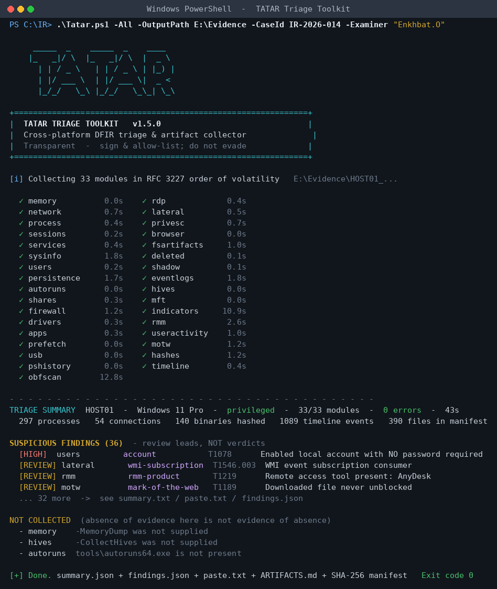
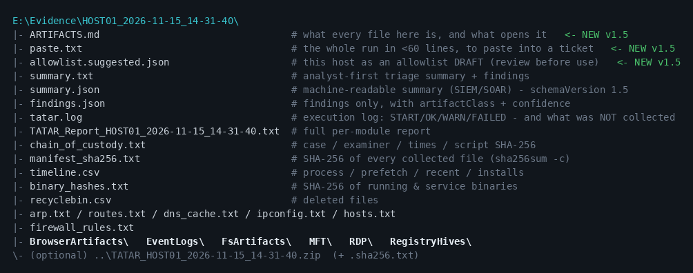
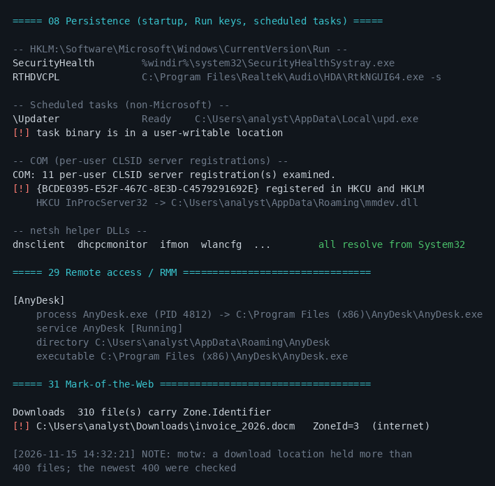

# Output, summary and log

[Монгол](OUTPUT.mn.md) · [← README](../README.md)

<p align="center">
  
</p>

<p align="center">
  
</p>

<p align="center">
  
</p>

## Triage summary & findings

Every run ends with an analyst-first one-pager so the IR lead knows **what to look at first**:

- **`summary.txt`** — host / OS / case metadata, quick stats (process count, listening ports, established connections, accounts, hashed binaries, … the same keys on every platform) and the aggregated **Suspicious findings** list, sorted by severity.
- **`summary.json`** — the same data as structured JSON (`stats`, `findings[]` with `Severity/Category/Message/Detail`), ready for SIEM ingestion or scripted post-processing.

Findings come from the collectors themselves: LOLBAS-style command lines, obfuscated-script matches, PsExec artifacts, WMI event-subscription consumers, unquoted / user-writable service paths, `AlwaysInstallElevated`, security-log-cleared (1102) events, executables recently dropped in temp locations, and more.

> **Important:** findings are automated pattern matches — **leads for review, not verdicts**. Legitimate software (updaters, IT tooling) regularly appears; validate each lead against the full report before drawing conclusions.

Each finding in `findings.json` also carries a `fingerprint` (16 hex characters) and a `contentHash`. The fingerprint says what the finding *is*: its module, artifact class, category, its message (a process ID or a count such as "12 files" is masked) and the paths it names. It does not depend on when the scan ran, so the same finding on the same host has the same fingerprint in every scan, and `tatar-diff.py` uses it to tell new from old. The `contentHash` covers severity, confidence and detail, so a finding that stays but gets worse shows as *changed*. An IOC feed hit on an existing finding keeps that finding's fingerprint and only changes its content hash; an indicator found in the evidence becomes a finding of its own whose message names the indicator, so each indicator has its own stable fingerprint.

## Execution log (`tatar.log`)

Each run writes a timestamped execution log alongside the evidence:

```
[2026-07-10 22:26:16.693] [START ] module sysinfo (1/30)
[2026-07-10 22:26:17.721] [OK    ] module sysinfo finished in 1s
[2026-07-10 22:26:17.751] [START ] module hives (26/30)
[2026-07-10 22:26:17.995] [ERROR ] Hives failed: Access denied
[2026-07-10 22:26:17.996] [WARN  ] module hives finished in 0.2s with 1 error(s)
```

`tatar.log` is an *operational* log (it keeps growing after the manifest is hashed), so it is deliberately **excluded from `manifest_sha256.txt`**. Evidence files are all hashed as usual. The manifest itself cannot hash itself, so its SHA-256 is printed at the end of the run and written beside it to `manifest_sha256.txt.sha256`.

## Output

```
C:\Forensic\<HOST>_<YYYY-MM-DD_HH-mm-ss>\
├─ ARTIFACTS.md                      # what every file here is, and what opens it   (NEW)
├─ paste.txt                         # the whole run in <60 lines, for a ticket     (NEW)
├─ allowlist.suggested.json          # this host as an allowlist DRAFT              (NEW)
├─ TATAR_Report_<HOST>_<stamp>.txt   # consolidated human-readable report
├─ summary.txt                       # analyst-first triage summary + findings
├─ summary.json                      # same, machine-readable (SIEM/automation)
├─ findings.json                     # findings-only feed for SOAR / SIEM
├─ tatar.log                         # execution log, and what was NOT collected
├─ chain_of_custody.txt              # case/examiner/times/script hash
├─ manifest_sha256.txt               # SHA-256 of every collected file, `sha256sum -c` format (tatar.log excluded)
├─ manifest_sha256.txt.sha256        # SHA-256 of the manifest itself (`sha256sum -c manifest_sha256.txt.sha256`)
├─ timeline.csv                      # process / prefetch / recent / installs
├─ binary_hashes.txt                 # SHA-256 of running/service binaries (VT/IOC)
├─ recyclebin.csv
├─ arp.txt / routes.txt / dns_cache.txt / ipconfig.txt / hosts.txt
├─ firewall_rules.txt
├─ BrowserArtifacts\ · EventLogs\ · FsArtifacts\ · RDP\ · RegistryHives\ · MFT\
└─ (optional) ..\TATAR_<HOST>_<stamp>.zip (+ .sha256.txt)
```
