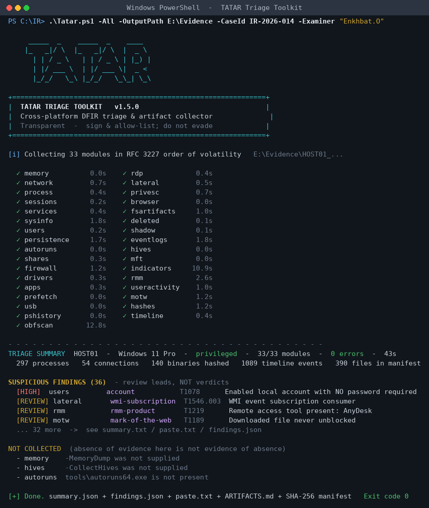
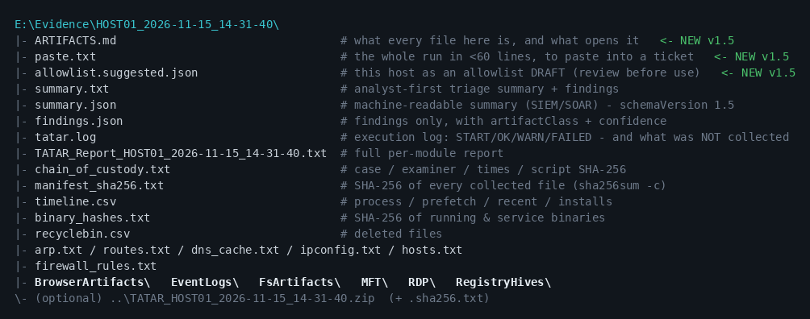
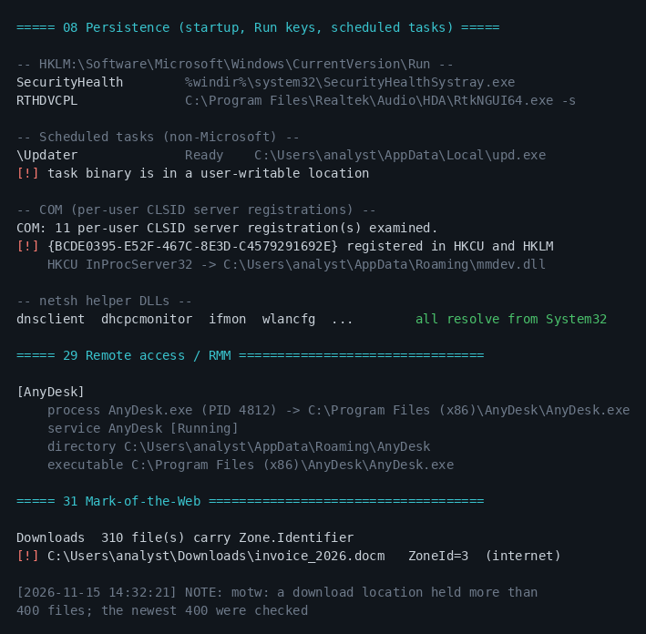

# Гаралт, дүгнэлт, лог

[English](OUTPUT.md) · [← README](../README.mn.md)

<p align="center">
  
</p>

<p align="center">
  
</p>

<p align="center">
  
</p>

## Triage дүгнэлт ба finding

Run бүр шинжээчид зориулсан нэг хуудсаар төгсдөг — IR ахлагч **юуг эхэлж харахаа** мэдэж авна:

- **`summary.txt`** — host / OS / case мета, quick stats (процессын тоо, listening port, established холболт, account, хэш тооцсон binary … платформ бүр дээр ижил түлхүүрүүд) болон severity-ээр эрэмбэлсэн **сэжигтэй finding**-үүдийн нэгтгэсэн жагсаалт.
- **`summary.json`** — ижил өгөгдөл бүтэцтэй JSON хэлбэрээр (`stats`, `Severity/Category/Message/Detail`-тай `findings[]`), SIEM-д залгих эсвэл скриптээр боловсруулахад бэлэн.

Finding-ууд collector-уудаас өөрсдөөс нь гарна: LOLBAS маягийн command line, обфускацитай скрипт, PsExec-ийн ул мөр, WMI event-subscription consumer, хашилтгүй / хэрэглэгч бичих эрхтэй service-ийн зам, `AlwaysInstallElevated`, security log цэвэрлэсэн (1102) event, temp хавтсанд саяхан үүссэн executable гэх мэт.

> **Чухал:** finding бол автомат pattern match — **review хийх сэжүүр, эцсийн дүгнэлт биш.** Хууль ёсны программ (updater, IT хэрэгсэл) байнга орж ирдэг; дүгнэлт гаргахаасаа өмнө сэжүүр бүрийг дэлгэрэнгүй тайлантай тулгаж баталгаажуул.

## Гүйцэтгэлийн лог (`tatar.log`)

Run бүр нотолгооны хажууд цаг тэмдэгтэй гүйцэтгэлийн лог бичнэ:

```
[2026-07-10 22:26:16.693] [START ] module sysinfo (1/30)
[2026-07-10 22:26:17.721] [OK    ] module sysinfo finished in 1s
[2026-07-10 22:26:17.751] [START ] module hives (26/30)
[2026-07-10 22:26:17.995] [ERROR ] Hives failed: Access denied
[2026-07-10 22:26:17.996] [WARN  ] module hives finished in 0.2s with 1 error(s)
```

`tatar.log` бол **ажиллагааны** лог — manifest хэшлэгдсэний дараа ч үргэлжлэн урсдаг тул `manifest_sha256.txt`-д **зориудаар оруулаагүй**. Нотолгооны файлууд бүгд ердийнхөөрөө хэшлэгдэнэ. Manifest өөрийгөө хэшлэж чадахгүй тул түүний SHA-256-г ажиллагааны төгсгөлд хэвлэж, хажууд нь `manifest_sha256.txt.sha256` болгон хадгална.

## Гаралт

```
<OutputPath>/<HOST>_<YYYY-MM-DD_HH-mm-ss>/
├─ ARTIFACTS.md                      # файл бүр юу болох, юугаар нээхийг хэлнэ   (ШИНЭ)
├─ paste.txt                         # бүтэн ажиллагаа <60 мөрөөр, тикетэд наахад (ШИНЭ)
├─ allowlist.suggested.json          # энэ хост allowlist-ийн НООРОГ болсон нь    (ШИНЭ)
├─ TATAR_Report_<HOST>_<stamp>.txt   # нэгдсэн, хүн уншихад зориулсан тайлан
├─ summary.txt                       # шинжээч-төвтэй triage дүгнэлт + findings
├─ summary.json                      # нэгдсэн schema (SIEM/автоматжуулалт)
├─ findings.json                     # findings-only feed (SOAR/SIEM)
├─ tatar.log                         # гүйцэтгэлийн лог, мөн юуг цуглуулж ЧАДААГҮЙ нь
├─ chain_of_custody.txt              # case/examiner/цаг/скриптийн hash
├─ manifest_sha256.txt               # файл бүрийн SHA-256 (`sha256sum -c`-гээр шалгаж болно)
├─ manifest_sha256.txt.sha256        # manifest өөрийнх нь SHA-256 (`sha256sum -c manifest_sha256.txt.sha256`)
├─ timeline.csv · binary_hashes.txt · ...
└─ (optional) TATAR_<HOST>_<stamp>.zip (+ .sha256)
```
